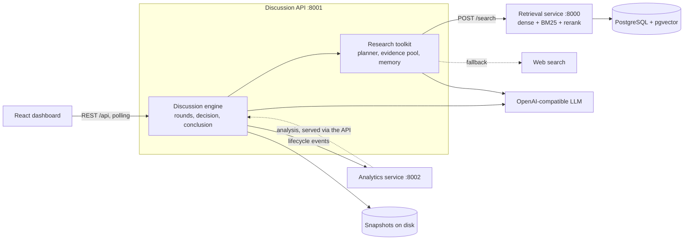

# Multi-Agent Research & Decision-Making Platform


A full-stack platform where specialized AI personas **research a decision together, debate it over multiple structured rounds, and converge on a recommendation**. A separate analytics service tracks how opinions change, align and influence each other as the discussion unfolds, and a React dashboard visualizes the whole process.

## 🎬 Demo

**[▶ Watch the Demo](https://drive.google.com/file/d/1MSNhHy7vnhfH6QE474udO5UZl25D0ktd/view?usp=sharing)**

## ✨ Key Features

- **Multi-agent discussions.** 3–6 of six specialized personas (for example capability, safety, cost and product perspectives) exchange structured, validated opinions on a directed agent graph.
- **Shared research with hybrid RAG.** A planner, evidence pool and consolidator build one research dossier for all agents. Retrieval combines dense search (BGE-M3 on pgvector), BM25, rank fusion and a cross-encoder reranker, with web search as a fallback.
- **Multi-round reasoning and decision synthesis.** 3–6 rounds (default 4) feed a deterministic decision summary with weighted criteria, followed by an LLM-written conclusion.
- **Session memory.** A rolling summary with LLM compaction carries context across research cycles and runs.
- **Event-driven analytics.** The discussion API emits lifecycle events; the analytics service processes them idempotently and computes opinion change, pairwise agreement, per-agent influence and sentiment as each round completes.
- **Interactive React dashboard.** Agent graph with message flow, transcript, round replay, discussion history, analytics charts and a conclusion view.
- **Reproducible and contract-driven.** Seeded participant selection, persisted snapshots per discussion and JSON Schemas for events and snapshots.

## 🏗️ System Architecture



| Component | Role |
|---|---|
| **Discussion engine** (`services/discussion-engine/discussion/`) | FastAPI producer. Selects participants, builds the agent graph, runs rounds, synthesizes the decision, writes the conclusion, persists snapshots and emits lifecycle events. |
| **Research toolkit** (`services/discussion-engine/week2/src/`) | Runs in the producer process. Plans queries, resolves evidence (retrieval first, web fallback by default), consolidates the dossier, defines personas and manages session memory. |
| **Retrieval service** (`services/discussion-engine/week2/Tools/RAG/`) | Separate FastAPI service started by the producer. Serves `POST /search` and `GET /health` over a PostgreSQL/pgvector corpus. |
| **Analytics service** (`services/analytics/`) | FastAPI consumer. Ingests events and updates a durable per-discussion analysis after each round and at completion. |
| **Frontend** (`frontend/`) | Submits objectives and polls the API every 1.5–2.5 s while a discussion runs. |

Lifecycle events are `discussion.started`, `round.completed`, `discussion.completed` and `discussion.failed`. The frontend never calls the analytics service directly; analysis is fetched through the discussion API.

## 🧰 Technology Stack

| Category | Technologies |
|---|---|
| **Backend** | Python 3.11+, FastAPI, Uvicorn, Pydantic v2 |
| **LLM orchestration** | LangGraph, LangChain, OpenAI SDK (any OpenAI-compatible endpoint) |
| **Retrieval** | PostgreSQL + pgvector, BGE-M3, rank-bm25, cross-encoder reranker (`ms-marco-MiniLM-L-6-v2`), DuckDuckGo search |
| **Analytics / NLP** | PyTorch, Transformers, NLI cross-encoder (`nli-deberta-v3-base`) |
| **Frontend** | React 18, TypeScript, Vite |
| **Tooling** | pytest, Docker (multi-stage build with pre-cached models) |

## ⚙️ How It Works

1. **Submit an objective.** Enter a topic, objective and constraints in the UI, or upload a `.txt`/`.md` file. Choose 3–6 rounds and 3–6 participants (random seeded or an explicit roster).
2. **Research.** The planner creates queries, the evidence pool resolves them (query expansion, relevance grading, retrieval then web fallback) and the consolidator produces one shared dossier.
3. **Seat the agents.** The selected personas are placed on a directed agent graph.
4. **Debate in rounds.** Each agent reads the dossier, its memory context and its neighbors' positions, then returns a structured opinion that is validated and committed. A snapshot is saved after each round.
5. **Decide and conclude.** After the final round the engine synthesizes a deterministic decision summary, then generates the written conclusion.
6. **Analyze.** Lifecycle events reach the analytics service, which computes opinion change, agreement, influence and sentiment. Analytics become available after round one.
7. **Review.** The dashboard shows the transcript, agent graph, analytics and conclusion, and keeps a history with round replay.

## 📁 Project Structure

```
.
├── main.py                      # Launcher: analytics service + discussion API
├── Dockerfile                   # Multi-stage build: frontend, backend, cached models
├── requirements.txt
├── frontend/                    # React + TypeScript + Vite dashboard
│   └── src/
│       └── analytics/           # Charts, analytics view, interaction graph
├── services/
│   ├── discussion-engine/
│   │   ├── discussion/          # Producer API, orchestration, decision, conclusion, events
│   │   ├── schemas/             # JSON Schemas for events and snapshots
│   │   ├── tests/
│   │   └── week2/               # Research toolkit (historical folder name)
│   │       ├── src/             # agents/, configs/ (Personas.yaml), helper/
│   │       ├── Tools/
│   │       │   ├── RAG/         # Retrieval service: api/, retrieval/, helper/
│   │       │   └── Web_Serach/  # Web-search fallback (name kept to preserve imports)
│   │       └── tests/
│   └── analytics/
│       ├── src/analytics/       # Ingestion, agreement, influence, sentiment, opinion change
│       └── tests/
├── scripts/                     # Model-cache scripts used by the Docker build
├── tests/                       # Launcher tests
└── docs/
    └── platform-reference.md    # API, environment variables, deployment, troubleshooting
```

## 🚀 Getting Started

### Prerequisites

- Python 3.11+ and Node.js 18+ (the Docker build uses Node 20)
- An API key for an OpenAI-compatible LLM endpoint
- A PostgreSQL database with pgvector and a pre-embedded document corpus (schema, ingestion scripts and corpus are not included in this repository)
- Disk space and bandwidth for the embedding, reranker and NLI models on first use

### Install

```bash
python -m venv .venv
source .venv/bin/activate        # Windows PowerShell: .venv\Scripts\Activate.ps1
python -m pip install -r requirements.txt -r services/analytics/requirements.txt
```

### Configure

Copy each template and fill in your values. Real `.env` files are git-ignored.

| Template | Copy to |
|---|---|
| `services/discussion-engine/.env.example` | `services/discussion-engine/.env` |
| `services/discussion-engine/week2/src/.env.example` | `services/discussion-engine/week2/src/.env` (LLM: `LLM_BASE_URL`, `LLM_MODEL`, `API_KEY`) |
| `services/discussion-engine/week2/Tools/RAG/helper/.env.example` | `services/discussion-engine/week2/Tools/RAG/helper/.env` (database connection) |
| `services/analytics/.env.example` | environment variables (see the file) |

### Run

```bash
python main.py
```

This starts the analytics service (`:8002`) and the discussion API (`:8001`); the API starts the retrieval service (`:8000`). Interactive docs are at `http://127.0.0.1:8001/docs` and `http://127.0.0.1:8002/docs`. In a second terminal:

```bash
cd frontend
npm install
npm run dev                      # http://127.0.0.1:5173, proxies /api to :8001
```

### Docker

```bash
docker build -t decision-platform-backend .
docker run -p 8001:8001 --env-file .env decision-platform-backend
```

The image serves the built frontend at `/` on port 8001. Environment variables, API endpoints and troubleshooting are documented in [docs/platform-reference.md](docs/platform-reference.md).

## 🧪 Testing

```bash
python -m pytest tests -q                                            # launcher
(cd services/analytics && python -m pytest tests -q)                 # analytics
(cd services/discussion-engine && python -m pytest tests -q)         # discussion engine
(cd services/discussion-engine && python -m pytest week2/tests -q)   # research toolkit, retrieval
(cd frontend && npm run build)                                       # TypeScript check + build
```
