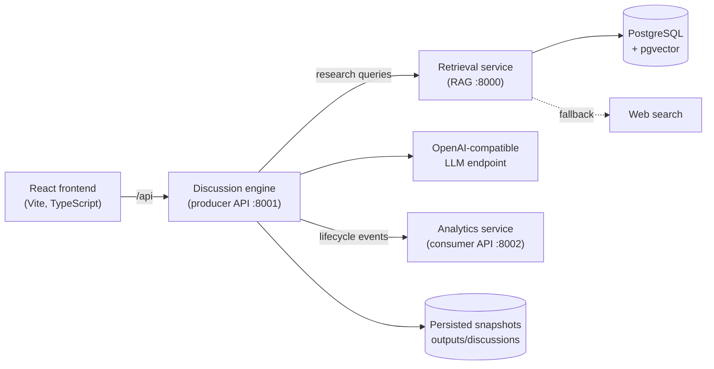

# Multi-Agent Research & Decision-Making Platform

A full-stack system in which several AI personas research a decision, debate it over multiple rounds, and converge on a recommendation, while a separate analytics service measures how opinions moved along the way.

---

## At a glance

| | |
|---|---|
| **Input** | A decision objective (topic, goal, constraints), typed into the UI or uploaded as a `.txt`/`.md` file |
| **Process** | Shared evidence research → 3–6 personas → 3–6 structured discussion rounds → decision synthesis → written conclusion |
| **Output** | Per-round opinion snapshots, a decision summary, an LLM-written conclusion, and analytics (opinion change, agreement, influence, sentiment) |
| **Stack** | Python · FastAPI · LangGraph · PostgreSQL/pgvector · Hugging Face models · React 18 · TypeScript · Vite · Docker |

## Architecture



`main.py` starts the producer and the analytics consumer together; the producer launches the retrieval service as a subprocess and serves the built frontend in the Docker image.

| Component | Location | Responsibility |
|---|---|---|
| **Discussion engine** | `services/discussion-engine/discussion/` | FastAPI producer: accepts objectives, runs rounds, synthesizes decisions, writes the conclusion, persists snapshots, emits lifecycle events |
| **Research toolkit** | `services/discussion-engine/week2/` | Research planner, evidence pool, evidence consolidator, personas, session memory, LLM client |
| **Retrieval service** | `services/discussion-engine/week2/Tools/RAG/` | Hybrid retrieval API (`/search`, `/health`) |
| **Analytics service** | `services/analytics/` | FastAPI consumer: ingests events and computes analytics per round and per discussion |
| **Frontend** | `frontend/` | Objective entry, discussion, analytics, conclusion, history and replay views |

## How a discussion runs

1. **Objective.** The user submits a topic, objective and optional constraints (or uploads an objective file). Rounds default to 4 (allowed range 3–6).
2. **Shared research.** A planner chooses research queries, an evidence pool resolves each one through retrieval (with query expansion, relevance grading and a source order of `rag,web` by default), and a consolidator turns the evidence into a neutral research dossier with evidence-tier tagging.
3. **Participants.** 3–6 personas are chosen from the six defined personas, either by seeded random selection (reproducible) or by an explicit roster. A directed agent graph connects them.
4. **Rounds.** Each round is executed synchronously: every persona receives the dossier and its neighbors' positions and returns a structured opinion, which is parsed, validated and committed.
5. **Decision synthesis.** Candidate assessments are combined with weighted criteria, with challenger selection and switch assessments, into a deterministic decision summary.
6. **Conclusion.** A cautious final narrative is generated from the last-round opinion records only.
7. **Events and analytics.** Lifecycle events (`discussion.started`, `round.completed`, `discussion.completed`, `discussion.failed`) are delivered to the analytics service, which processes them idempotently and exposes per-round and per-discussion analysis.

## Features

- **Persona-driven debate** with structured, validated opinion records instead of free-form chat.
- **Hybrid retrieval**: dense search (BGE-M3 over pgvector), BM25, reciprocal rank fusion, metadata/similarity/dedup filters and a cross-encoder reranker, with web-search fallback.
- **Session memory** with rolling-summary compaction across research cycles.
- **Reproducibility**: seeded participant selection and persisted snapshots per discussion.
- **Analytics**: opinion change, pairwise agreement, per-agent influence and candidate-directed sentiment (NLI model when only prose is available).
- **Typed contracts**: JSON Schemas for events and snapshots (`services/discussion-engine/schemas/`) and idempotent event delivery.
- **Interactive UI**: discussion, analytics and conclusion views, an interaction graph, discussion history and round replay.
- **Containerized**: multi-stage Dockerfile that builds the frontend and pre-caches pinned model revisions so containers do not download models at startup.

## The six personas

| Persona | Perspective |
|---|---|
| Capability Maximizer | Transformer architectures, scaling and maximizing capability under constrained compute |
| Practical Systems Architect | Reliable, maintainable, efficient, practical-to-deploy systems |
| Safety and Governance Advocate | Misuse, alignment, accountability and privacy |
| Product and User Advocate | Solving real problems, accessibility and reliable user value |
| Cost and Sustainability Analyst | Total cost, resource efficiency, energy use and long-term viability |
| Strategic Consensus Builder | Synthesizing competing technical perspectives |

Persona definitions live in `services/discussion-engine/week2/src/configs/Personas.yaml`. They are written for **AI / Transformer-architecture decisions**; using the platform for other domains would mean rewriting them.

## Technology

| Area | Technologies |
|---|---|
| Backend | Python 3.11, FastAPI, Uvicorn, Pydantic v2, pydantic-settings |
| Agents and LLM | LangGraph, LangChain (core, OpenAI, community), OpenAI SDK against any OpenAI-compatible endpoint |
| Retrieval | PostgreSQL + pgvector (psycopg2), BGE-M3 embeddings, rank-bm25, cross-encoder reranker (`ms-marco-MiniLM-L-6-v2`), DuckDuckGo web search |
| Analytics | PyTorch, Transformers, NLI cross-encoder (`nli-deberta-v3-base`) |
| Frontend | React 18, TypeScript 5, Vite 5, lucide-react |
| Quality and delivery | pytest, Docker (Node 20 build stage, Python 3.11-slim runtime) |

## Repository layout

```
.
├── main.py                  Unified launcher (producer + analytics consumer)
├── Dockerfile               Multi-stage build (frontend, backend, cached models)
├── requirements.txt         Python dependencies
├── frontend/                React single-page app
├── services/
│   ├── discussion-engine/   Producer API, research toolkit, retrieval service, schemas
│   └── analytics/           Analytics consumer API
├── scripts/                 Model-caching scripts used by the Dockerfile
├── tests/                   Launcher tests
└── docs/
    └── platform-reference.md   Detailed API, configuration and troubleshooting reference
```

## Getting started

### Prerequisites

- Python 3.11+ and Node.js 18+ (the Docker build uses Node 20).
- An API key for an **OpenAI-compatible LLM endpoint**. The example configuration points at `https://ollama.com/v1`; set `LLM_BASE_URL`, `LLM_MODEL` and `API_KEY` for your provider.
- **A PostgreSQL database with pgvector and a pre-embedded document corpus.** The retrieval service reads from it, and the API returns `503 rag_warming_up` for new discussions until retrieval is ready. **This repository does not include the database schema, ingestion scripts or corpus**, so a fresh clone cannot run a full discussion until you provide one. The connection settings are in `services/discussion-engine/week2/Tools/RAG/helper/.env.example`.
- Enough disk space and bandwidth to download the embedding, reranker and NLI models on first use.

### Install

```bash
python -m venv .venv
source .venv/bin/activate            # Windows PowerShell: .venv\Scripts\Activate.ps1
python -m pip install -r requirements.txt -r services/analytics/requirements.txt
```

### Configure

Copy each template and fill in your values:

| Template | Copy to |
|---|---|
| `services/discussion-engine/.env.example` | `services/discussion-engine/.env` |
| `services/discussion-engine/week2/src/.env.example` | `services/discussion-engine/week2/src/.env` |
| `services/discussion-engine/week2/Tools/RAG/helper/.env.example` | `services/discussion-engine/week2/Tools/RAG/helper/.env` |
| `services/analytics/.env.example` | environment variables (see the file) |

Never commit real `.env` files; they are git-ignored.

### Run

```bash
python main.py                       # starts the analytics consumer, producer and retrieval service
```

| Service | URL |
|---|---|
| Retrieval service | http://127.0.0.1:8000 |
| Discussion API docs | http://127.0.0.1:8001/docs |
| Analytics API docs | http://127.0.0.1:8002/docs |

In a second terminal:

```bash
cd frontend
npm install
npm run dev                          # http://127.0.0.1:5173, proxies /api to :8001
```

### Docker

```bash
docker build -t decision-platform-backend .
docker run -p 8001:8001 --env-file .env decision-platform-backend
```

The image bakes in the built frontend, which the producer serves at `/`. See [docs/platform-reference.md](docs/platform-reference.md) for details.

## Testing

```bash
python -m pytest tests -q                                            # launcher
(cd services/analytics && python -m pytest tests -q)                 # analytics
(cd services/discussion-engine && python -m pytest tests -q)         # discussion engine
(cd services/discussion-engine && python -m pytest week2/tests -q)   # research toolkit and retrieval
```

There are no frontend tests.

## Known limitations

- The retrieval database and corpus are not included (see Prerequisites).
- The personas are specific to AI / Transformer-architecture decisions.
- `services/analytics/tests/test_influence.py` imports `_tfidf_relevance_scores`, which does not exist in `analytics/influence.py`, so that test file fails at collection.
- Two tests (`test_upload_is_queued_for_background_execution`) need working LLM credentials and network access.
- The `Tools/Web_Serach` folder name is a historical typo that is kept so existing imports keep working.

## Documentation

- [Platform reference](docs/platform-reference.md): endpoints, environment variables, deployment and troubleshooting
- [Discussion engine](services/discussion-engine/README.md)
- [Analytics service](services/analytics/README.md)

## Acknowledgments

This project was developed collaboratively.

It builds on open-source software and models, including FastAPI, LangGraph, LangChain, PyTorch, Hugging Face Transformers and Sentence-Transformers, React and Vite, the `BAAI/bge-m3` embedding model, the `cross-encoder/ms-marco-MiniLM-L-6-v2` reranker and the `cross-encoder/nli-deberta-v3-base` NLI model. Each is subject to its own license.

## License

No license has been selected yet. Until one is added, all rights are reserved by the authors.
